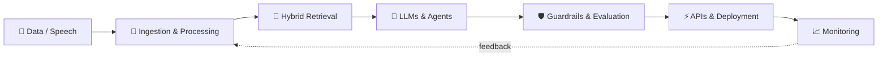

  

   

  

  

    
    
    
    
  

## `01 / ABOUT ME`

I'm an **AI / Machine Learning Engineer** with **3+ years of combined industry and research experience**, focused on turning AI ideas into reliable software.

My work spans **LLM applications, agentic workflows, retrieval-augmented generation, Arabic NLP, voice systems, model optimization, and MLOps**. I care about the parts that make AI useful outside a notebook: retrieval quality, latency, evaluation, security, deployment, and monitoring.

Previously, I worked as a **Senior Machine Learning Engineer / Team Lead**, delivering applied AI systems in restricted-network environments. Some enterprise work is not public; the repositories below demonstrate the engineering patterns I can share.

<table>
  <tr>
    <td width="33%" align="center"><strong>🧠 AGENTIC SYSTEMS</strong> LangGraph · tool use · multi-step reasoning</td>
    <td width="34%" align="center"><strong>🔎 TRUSTWORTHY RAG</strong> hybrid retrieval · reranking · evaluation</td>
    <td width="33%" align="center"><strong>🚀 AI IN PRODUCTION</strong> APIs · offline inference · MLOps</td>
  </tr>
</table>

## `02 / FEATURED BUILDS`

<table>
  <tr>
    <td width="50%" valign="top">
      <h3>🧠 <a href="https://github.com/FaizanAKhan786/muhawir">Muḥāwir</a> محاور</h3>
      <b>Bilingual agentic knowledge assistant</b>
      
Arabic/English knowledge assistant combining LangGraph orchestration, hybrid BM25 + vector retrieval, reranking, semantic caching, guardrails, and an evaluation pipeline.

      <code>LangGraph</code> <code>Qdrant</code> <code>FastAPI</code> <code>RAGAS</code>
      
<a href="https://github.com/FaizanAKhan786/muhawir">Explore repository →</a>

    </td>
    <td width="50%" valign="top">
      <h3>🗣️ <a href="https://github.com/FaizanAKhan786/lahja">Lahja</a> لهجة</h3>
      <b>Gulf Arabic LLM adaptation pipeline</b>
      
Config-driven dialect fine-tuning with QLoRA, evaluation, quantization/export, and streaming model serving designed with offline deployment in mind.

      <code>PyTorch</code> <code>QLoRA</code> <code>Transformers</code> <code>FastAPI</code>
      
<a href="https://github.com/FaizanAKhan786/lahja">Explore repository →</a>

    </td>
  </tr>
  <tr>
    <td width="50%" valign="top">
      <h3>🎙️ <a href="https://github.com/FaizanAKhan786/sada-voice-ai">SADA Voice AI</a> صدى</h3>
      <b>Interruptible bilingual voice assistant</b>
      
Arabic/English customer-support prototype with browser audio, WebSocket streaming, voice activity detection, interruption handling, and optional LLM-based answers.

      <code>FastAPI</code> <code>WebSockets</code> <code>Whisper</code> <code>Ollama</code>
      
<a href="https://github.com/FaizanAKhan786/sada-voice-ai">Source code →</a> · <a href="https://sada-voice-ai.onrender.com">Try the public demo →</a>

    </td>
    <td width="50%" valign="top">
      <h3>🏢 <a href="https://github.com/FaizanAKhan786/offline-enterprise-copilot">Offline Enterprise Copilot</a></h3>
      <b>Private, local-first AI assistant architecture</b>
      
Enterprise copilot project bringing together local LLM inference, document RAG, agent workflows, access control, and an observability stack.

      <code>Ollama</code> <code>Qdrant</code> <code>Docker</code> <code>Prometheus</code>
      
<a href="https://github.com/FaizanAKhan786/offline-enterprise-copilot">Explore repository →</a>

    </td>
  </tr>
  <tr>
    <td width="50%" valign="top">
      <h3>🛡️ <a href="https://github.com/FaizanAKhan786/agentic-redteam-auditor">Agentic Red-Team Auditor</a></h3>
      <b>Security testing for AI agents</b>
      
Auditor that tests a deliberately vulnerable tool-using RAG agent for prompt injection, retrieval poisoning, tool misuse, and other failure modes.

      <code>Python</code> <code>LangGraph</code> <code>FAISS</code> <code>Pytest</code>
      
<a href="https://github.com/FaizanAKhan786/agentic-redteam-auditor">Explore repository →</a>

    </td>
    <td width="50%" valign="top">
      <h3>🎯 <a href="https://github.com/FaizanAKhan786/interviewlens-ai">InterviewLens AI</a></h3>
      <b>Multimodal interview feedback platform</b>
      
Analyze recorded interviews, review answer quality and speech patterns, identify knowledge gaps, and generate personalized practice plans.

      <code>Python</code> <code>FastAPI</code> <code>Speech AI</code> <code>Video</code>
      
<a href="https://github.com/FaizanAKhan786/interviewlens-ai">Explore repository →</a>

    </td>
  </tr>
</table>

  <a href="https://github.com/FaizanAKhan786/production-rag-chatbot"><b>Production RAG Chatbot</b></a> &nbsp;·&nbsp;
  <a href="https://github.com/FaizanAKhan786/faizan-ai-portfolio"><b>Interactive AI Portfolio</b></a> &nbsp;·&nbsp;
  <a href="https://github.com/FaizanAKhan786?tab=repositories"><b>All repositories ↗</b></a>

## `03 / ENGINEERING TOOLKIT`

| Layer | Technologies |
|:--|:--|
| **Core ML & NLP** | Python · PyTorch · TensorFlow · Scikit-learn · Hugging Face Transformers · Arabic NLP |
| **Generative & Agentic AI** | LangGraph · LangChain · LlamaIndex · Ollama · model fine-tuning · tool calling |
| **Retrieval & Data** | Qdrant · FAISS · ChromaDB · BM25 · PostgreSQL / pgvector · Redis · Neo4j |
| **Serving & Voice** | FastAPI · Flask · WebSockets · Whisper · OCR · REST APIs |
| **Delivery & MLOps** | Docker · Kubernetes · MLflow · GitLab CI/CD · Prometheus · Grafana · AWS / Azure / GCP |

  

## `04 / HOW I THINK ABOUT AI SYSTEMS`

I enjoy working across the full engineering loop, not just the model layer.

**Engineering interests:** bilingual RAG, long-running AI agents, voice-to-voice experiences, reliable evaluation, secure tool use, and AI systems that work without cloud connectivity.

## `05 / EXPERIENCE & LEARNING`

- **Applied AI & team leadership:** worked on ML systems from experimentation through deployment, with a focus on practical reliability and operational constraints.
- **Specialist work:** English–Arabic neural machine translation, OCR, offline model inference, multimodal RAG, and production monitoring. Some implementations are private due to workplace requirements.
- **Education:** M.Tech in Computer Science & Engineering (AI specialization), **NIT Jalandhar**; B.Tech in Computer Science & Engineering, **Jamia Hamdard**.
- **Beyond coursework:** selected for **Amazon ML Summer School 2024**; **LeetCode Knight**.

## `06 / LET'S BUILD SOMETHING USEFUL`

I'm interested in **AI Engineer · Applied AI Engineer · Generative AI / LLM Engineer · Machine Learning Engineer · MLOps Engineer** opportunities, and in collaborating on thoughtful open-source AI projects.

  <a href="https://www.linkedin.com/in/faizan-ahmedkhan/"><strong>LinkedIn</strong></a> &nbsp; / &nbsp;
  <a href="mailto:Khanfaizan1532001@gmail.com"><strong>Email</strong></a> &nbsp; / &nbsp;
  <a href="https://github.com/FaizanAKhan786/faizan-ai-portfolio"><strong>Portfolio project</strong></a>

Build the system. Measure the outcome. Improve what matters.

