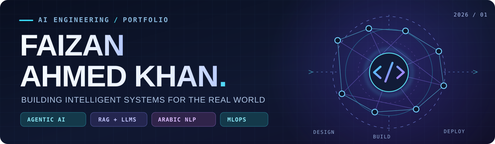
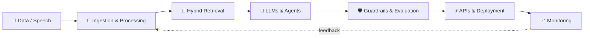

  

   

  

  

    
    
    
    
  

## `01 / ABOUT ME`

I'm an **AI / Machine Learning Engineer** with **3+ years of combined industry and research experience**, focused on turning AI ideas into reliable software.

My work spans **LLM applications, agentic workflows, retrieval-augmented generation, Arabic NLP, voice systems, model optimization, and MLOps**. I care about the parts that make AI useful outside a notebook: retrieval quality, latency, evaluation, security, deployment, and monitoring.

Previously, I worked as a **Senior Machine Learning Engineer / Team Lead**, delivering applied AI systems in restricted-network environments. Some enterprise work is not public; the repositories below demonstrate the engineering patterns I can share.

<table>
  <tr>
    <td width="33%" align="center"><strong>🧠 AGENTIC SYSTEMS</strong> LangGraph · tool use · multi-step reasoning</td>
    <td width="34%" align="center"><strong>🔎 TRUSTWORTHY RAG</strong> hybrid retrieval · reranking · evaluation</td>
    <td width="33%" align="center"><strong>🚀 AI IN PRODUCTION</strong> APIs · offline inference · MLOps</td>
  </tr>
</table>

## `02 / FEATURED AI SYSTEMS`

Every project below links to its source, technical architecture and setup guide. The graphics are **original conceptual system illustrations**, not fabricated UI screenshots.

<table>
  <tr>
    <td width="50%" valign="top">
      
      <h3><a href="https://github.com/FaizanAKhan786/muhawir">Muḥāwir | محاور</a></h3>
      
<b>Bilingual agentic knowledge assistant</b>

      
LangGraph agent workflows, Arabic/English processing, hybrid retrieval, reranking, guardrails and quality checks.

      
<code>LangGraph · Qdrant · RAGAS</code>

      
<a href="https://github.com/FaizanAKhan786/muhawir">Code + setup</a> · <a href="https://github.com/FaizanAKhan786/muhawir#architecture">Architecture</a>

      
    </td>
    <td width="50%" valign="top">
      
      <h3><a href="https://github.com/FaizanAKhan786/sada-voice-ai">SADA Voice AI | صدى</a></h3>
      
<b>Interruptible bilingual voice prototype</b>

      
Arabic/English browser speech, WebSocket sessions, optional LLM answers and deterministic synthetic support workflows.

      
<code>FastAPI · Voice · WebSockets</code>

      
<a href="https://github.com/FaizanAKhan786/sada-voice-ai">Code + setup</a> · <a href="https://github.com/FaizanAKhan786/sada-voice-ai#architecture">Architecture</a> · <a href="https://sada-voice-ai.onrender.com">Hosted demo (availability varies)</a>

      
    </td>
  </tr>
  <tr>
    <td width="50%" valign="top">
      
      <h3><a href="https://github.com/FaizanAKhan786/lahja">Lahja | لهجة</a></h3>
      
<b>Gulf Arabic language model adaptation</b>

      
Configurable dialect data preparation, QLoRA training, model evaluation, quantization and local inference API.

      
<code>QLoRA · Transformers · FastAPI</code>

      
<a href="https://github.com/FaizanAKhan786/lahja">Code + setup</a> · <a href="https://github.com/FaizanAKhan786/lahja#architecture">Architecture</a>

      
    </td>
    <td width="50%" valign="top">
      
      <h3><a href="https://github.com/FaizanAKhan786/offline-enterprise-copilot">Offline Enterprise Copilot</a></h3>
      
<b>Private-first AI platform architecture</b>

      
Locally served LLMs, document RAG, FastAPI orchestration and operational integrations for restricted networks.

      
<code>Ollama · Qdrant · Docker</code>

      
<a href="https://github.com/FaizanAKhan786/offline-enterprise-copilot">Code + setup</a> · <a href="https://github.com/FaizanAKhan786/offline-enterprise-copilot#architecture">Architecture</a>

      
    </td>
  </tr>
  <tr>
    <td width="50%" valign="top">
      
      <h3><a href="https://github.com/FaizanAKhan786/agentic-redteam-auditor">Agentic Red-Team Auditor</a></h3>
      
<b>Defensive AI security testing</b>

      
Explore prompt injection, tool-use risks and retrieval poisoning safely with a seeded target harness and scored findings.

      
<code>Python · RAG · Security</code>

      
<a href="https://github.com/FaizanAKhan786/agentic-redteam-auditor">Code + setup</a> · <a href="https://github.com/FaizanAKhan786/agentic-redteam-auditor#architecture">Architecture</a>

      
    </td>
    <td width="50%" valign="top">
      
      <h3><a href="https://github.com/FaizanAKhan786/interviewlens-ai">InterviewLens AI</a></h3>
      
<b>Recorded interview feedback and practice</b>

      
Interview recording analysis, technical rubrics, learning plans, and practice workflows in a portfolio prototype.

      
<code>FastAPI · Multimodal · Coaching</code>

      
<a href="https://github.com/FaizanAKhan786/interviewlens-ai">Code + setup</a> · <a href="https://github.com/FaizanAKhan786/interviewlens-ai#architecture">Architecture</a>

      
    </td>
  </tr>
</table>

**Real product screenshot:** [SADA Studio dashboard](https://github.com/FaizanAKhan786/sada-voice-ai/blob/main/docs/dashboard.png) · **Additional builds:** [Production RAG Chatbot](https://github.com/FaizanAKhan786/production-rag-chatbot) · [Interactive AI Portfolio](https://github.com/FaizanAKhan786/faizan-ai-portfolio)

### Build quality and reproducibility

GitHub Actions badges reflect the current workflows, not claimed test pass rates. These projects have different test coverage and runtime requirements.

  &nbsp;
  &nbsp;
  &nbsp;
  &nbsp;
  

## `03 / ENGINEERING TOOLKIT`

| Layer | Technologies |
|:--|:--|
| **Core ML & NLP** | Python · PyTorch · TensorFlow · Scikit-learn · Hugging Face Transformers · Arabic NLP |
| **Generative & Agentic AI** | LangGraph · LangChain · LlamaIndex · Ollama · model fine-tuning · tool calling |
| **Retrieval & Data** | Qdrant · FAISS · ChromaDB · BM25 · PostgreSQL / pgvector · Redis · Neo4j |
| **Serving & Voice** | FastAPI · Flask · WebSockets · Whisper · OCR · REST APIs |
| **Delivery & MLOps** | Docker · Kubernetes · MLflow · GitLab CI/CD · Prometheus · Grafana · AWS / Azure / GCP |

  

## `04 / HOW I THINK ABOUT AI SYSTEMS`

I enjoy working across the full engineering loop, not just the model layer.

**Engineering interests:** bilingual RAG, long-running AI agents, voice-to-voice experiences, reliable evaluation, secure tool use, and AI systems that work without cloud connectivity.

## `05 / EXPERIENCE & LEARNING`

- **Applied AI & team leadership:** worked on ML systems from experimentation through deployment, with a focus on practical reliability and operational constraints.
- **Specialist work:** English–Arabic neural machine translation, OCR, offline model inference, multimodal RAG, and production monitoring. Some implementations are private due to workplace requirements.
- **Education:** M.Tech in Computer Science & Engineering (AI specialization), **NIT Jalandhar**; B.Tech in Computer Science & Engineering, **Jamia Hamdard**.
- **Beyond coursework:** selected for **Amazon ML Summer School 2024**; **LeetCode Knight**.

## `06 / LET'S BUILD SOMETHING USEFUL`

I'm interested in **AI Engineer · Applied AI Engineer · Generative AI / LLM Engineer · Machine Learning Engineer · MLOps Engineer** opportunities, and in collaborating on thoughtful open-source AI projects.

  <a href="https://www.linkedin.com/in/faizan-ahmedkhan/"><strong>LinkedIn</strong></a> &nbsp; / &nbsp;
  <a href="mailto:Khanfaizan1532001@gmail.com"><strong>Email</strong></a> &nbsp; / &nbsp;
  <a href="https://github.com/FaizanAKhan786/faizan-ai-portfolio"><strong>Portfolio project</strong></a>

Build the system. Measure the outcome. Improve what matters.

